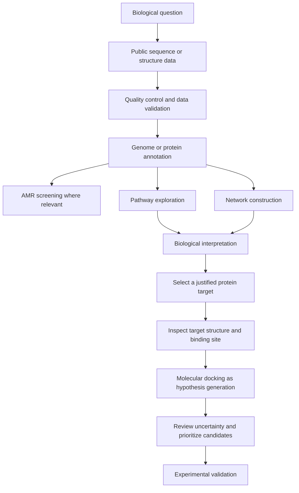

from pathlib import Path

content = r'''# Module 4: Computer-Aided Drug Design and Systems Biology

> **Course:** *Culture to Code and Beyond “BLAST”*  
> **Module theme:** Computer-Aided Drug Design (CADD) and Systems Biology  
> **Suggested format:** Conceptual reading + guided, non-coding practicals  
> **Prerequisites:** Basic molecular biology, proteins, DNA/RNA sequences, and introductory bioinformatics

---

## Learning objectives

By the end of this module, learners should be able to:

1. Explain how computational approaches support early-stage drug discovery.
2. Describe a protein target, ligand, binding pocket, and molecular docking score.
3. Outline a beginner-friendly molecular docking workflow using graphical tools.
4. Explain antimicrobial resistance (AMR) genes and the limits of sequence-based resistance prediction.
5. Explore biological pathways using KEGG and BioCyc.
6. Describe biological networks and distinguish gene-regulatory, protein–protein interaction, and host–pathogen networks.
7. Interpret computational results cautiously and identify the experimental evidence needed to validate them.
8. Document an analysis so that another researcher can reproduce it.

## Module map

| Topic | Main question | Example |
|---|---|---|
| Computer-Aided Drug Design | How can a molecule be assessed as a possible binder to a protein? | Docking a small molecule to a protein structure |
| Molecular docking | Which poses may fit a binding pocket, and how are poses ranked? | Comparing poses in a bacterial enzyme |
| AMR bioinformatics | Which known resistance-associated genes or variants are present? | Screening a bacterial genome for resistance determinants |
| Pathway analysis | Which biological processes connect a set of genes? | Exploring bacterial metabolism or a host immune pathway |
| Systems biology | How do interacting components produce a biological response? | Mapping a host–pathogen interaction network |

---

# 1. Introduction: From biological data to biological systems

Bioinformatics is often introduced through sequence searching, sequence alignment, genome analysis, and protein structure. These approaches help answer questions about individual biological components. Many research questions, however, require connecting those components to a larger system.

For example, identifying a bacterial gene is only the beginning of an investigation. Researchers may also want to know:

- Does the gene encode a protein with a known biological function?
- Does that protein participate in a metabolic pathway?
- Is the protein a possible drug target?
- Is the gene associated with antimicrobial resistance?
- Which other genes, proteins, or host factors interact with it?
- What evidence would be needed to test the computational prediction?

**Computer-Aided Drug Design (CADD)** uses computational methods to support the identification and prioritization of potential drug candidates. **Systems biology** studies biological components and their interactions as connected systems rather than as isolated parts.

These fields overlap. A drug may bind to one protein, but the biological consequences of that interaction depend on the protein's function, the pathway in which it participates, compensatory responses, and the wider cellular environment.

### Biological example: finding a possible antibacterial target

Imagine a study of a bacterial pathogen. A research team identifies a protein that is required for an essential cellular process and appears sufficiently different from its human counterpart to merit investigation.

A computational workflow might:

1. Retrieve or predict the protein structure.
2. Inspect the structure for a plausible ligand-binding pocket.
3. Use molecular docking to rank candidate molecules for further investigation.
4. Examine whether the protein is part of an essential pathway.
5. review literature and databases for known inhibitors and safety concerns.
6. Test the most promising hypotheses experimentally.

The computational workflow helps prioritize work. It does **not** prove that a candidate is an effective, safe, selective, or clinically useful drug.

---

# 2. Computer-Aided Drug Design (CADD)

## 2.1 What is CADD?

Computer-Aided Drug Design refers to computational approaches used to support the discovery and optimization of molecules that may alter the activity of a biological target. A target may be a protein, enzyme, receptor, nucleic acid, or another biomolecule.

CADD can help researchers prioritize compounds, understand possible binding interactions, explore structure–activity relationships, and reduce the number of candidates that need to be tested experimentally.

CADD is not a single software package. It is a collection of methods that can include:

- **Structure-based drug design:** uses a three-dimensional structure of the biological target.
- **Ligand-based drug design:** uses information from known active compounds or related molecules.
- **Virtual screening:** computationally evaluates a collection of compounds to prioritize candidates.
- **Molecular docking:** predicts plausible orientations of a ligand in a target's binding site and scores those poses.
- **Molecular dynamics:** simulates how atoms may move over time under a chosen physical model.
- **ADMET prediction:** estimates absorption, distribution, metabolism, excretion, and toxicity-related properties.

Different methods answer different questions. A docking score, for example, is not a substitute for toxicity testing or a measurement of drug effectiveness.

## 2.2 Key terms

| Term | Meaning |
|---|---|
| **Drug target** | A biological molecule whose activity is intended to be modified by a candidate compound |
| **Ligand** | A molecule that binds to another molecule; in docking, often a small molecule being evaluated |
| **Binding site/pocket** | A region of a target where a ligand may bind |
| **Binding pose** | A predicted three-dimensional orientation and conformation of a ligand in a binding site |
| **Docking score** | A model-dependent numerical score used to rank poses or compounds |
| **Hit** | A compound that shows a promising signal in an initial screen and needs follow-up |
| **Lead compound** | A candidate with evidence supporting further optimization |
| **Selectivity** | The extent to which a compound acts on its intended target rather than other targets |
| **Off-target effect** | An effect caused by interaction with a molecule other than the intended target |
| **ADMET** | Absorption, distribution, metabolism, excretion, and toxicity |

## 2.3 Why protein structures matter

Proteins fold into three-dimensional shapes. Their surfaces contain grooves, pockets, charged regions, and other features that can influence molecular recognition. A ligand may interact with a pocket through a combination of hydrogen bonds, electrostatic interactions, hydrophobic contacts, van der Waals interactions, and sometimes metal coordination.

A protein structure can be obtained from experimental methods such as X-ray crystallography, nuclear magnetic resonance, or cryo-electron microscopy. Predicted structures can also be useful, but the reliability of the relevant region must be considered.

A structure should not be treated as a perfect, motionless representation of a protein. Proteins can change conformation; water molecules, ions, cofactors, protonation states, and neighboring molecules may affect binding. A pocket that looks suitable in one structure may not behave the same way under biological conditions.

### Biological example: enzyme inhibition

Many antibiotics work by inhibiting bacterial processes. In principle, a compound that binds to the active site of an essential bacterial enzyme may interfere with the enzyme's function. Docking can suggest whether a molecule may fit in that site and identify interactions to investigate.

However, a predicted fit does not establish that the compound enters bacterial cells, reaches the target at a sufficient concentration, avoids rapid degradation, or inhibits the enzyme in a laboratory assay.

## 2.4 Structure-based versus ligand-based design

| Feature | Structure-based approach | Ligand-based approach |
|---|---|---|
| Main input | A three-dimensional target structure | Known ligands and their activity data |
| Example methods | Docking, structure-based virtual screening | Similarity searching, pharmacophore modeling, QSAR |
| Useful when | The target structure and binding site are sufficiently characterized | Several relevant compounds with reliable activity data are available |
| Main limitation | Structure quality and scoring approximations affect predictions | Predictions depend on the quality and coverage of known compound data |

A research project may combine both approaches. For example, ligand similarity can identify compounds related to known inhibitors, while docking can help generate hypotheses about their possible binding modes.

---

# 3. Molecular docking

## 3.1 What is molecular docking?

Molecular docking is a computational method that searches for plausible ways a ligand can be positioned within a target's binding site. The program samples possible ligand orientations and conformations and uses a scoring function to rank the resulting poses.

Docking commonly produces:

- One or more predicted ligand poses.
- A score for each pose, based on the program's scoring function.
- A structure file that can be visualized and inspected.
- Sometimes a list of nearby residues or predicted contacts.

Docking is useful for generating hypotheses and prioritizing candidates. It is not direct evidence that binding occurs.

## 3.2 How docking works conceptually

A typical docking workflow has the following stages:

1. **Choose a target:** select a protein relevant to a well-defined biological question.
2. **Obtain the structure:** retrieve a suitable experimental or predicted structure.
3. **Prepare the target:** inspect missing residues, alternate conformations, waters, cofactors, ions, and other structural features. Preparation choices must be justified.
4. **Choose a ligand:** retrieve a known ligand or a candidate molecule with a clear identity.
5. **Prepare the ligand:** check its chemical structure, stereochemistry, protonation state, and relevant conformations.
6. **Define the search region:** specify the binding pocket or region to explore.
7. **Run docking:** sample poses and score them.
8. **Inspect the poses:** look for plausible geometry and chemically reasonable interactions.
9. **Compare cautiously:** use scores as one line of evidence, not as a stand-alone verdict.
10. **Plan validation:** propose experiments such as enzyme inhibition, binding assays, or appropriate cellular assays.

## 3.3 Interpreting docking scores

Docking programs use different scoring functions and conventions. In many commonly used docking tools, a more negative score is ranked as more favorable **within that tool and setup**. This does not mean that the molecule will necessarily bind more strongly in an experiment.

Avoid these common errors:

- Comparing scores from different docking programs as if they were on the same scale.
- Treating a small score difference as proof that one compound is better.
- Concluding that a compound is a drug because it has a favorable score.
- Ignoring ligand preparation, target preparation, protonation, flexibility, or the chosen search region.
- Treating every visually attractive interaction as biologically meaningful.

A sensible analysis combines pose inspection, known structural information, controls, chemical plausibility, independent evidence, and experimental validation.

## 3.4 Common non-covalent interactions

- **Hydrogen bonds:** directional interactions involving a hydrogen attached to an electronegative atom and another suitable atom.
- **Hydrophobic contacts:** interactions between non-polar surfaces that can help stabilize a complex.
- **Electrostatic interactions:** attractions or repulsions between charged or partially charged groups.
- **van der Waals contacts:** weak interactions that depend strongly on distances between atoms.
- **Aromatic interactions:** interactions involving aromatic rings, including stacking or edge-to-face arrangements.
- **Metal coordination:** interactions between a ligand and a metal ion at a suitable site.

A short distance between two atoms is not enough to confirm a favorable interaction. Geometry, atom types, protonation, solvent, and the chemical environment matter.

---

# 4. Practical Guide A: Introductory docking with a graphical interface

## Aim

To explore how a small molecule can be placed into a protein binding pocket, inspect predicted interactions, and explain the limitations of docking.

## Recommended software and resources

- **PyRx:** graphical interface commonly used for virtual screening workflows; availability and supported components may vary by installation.
- **AutoDock Vina:** docking engine used by many docking interfaces.
- **PyMOL** or **UCSF ChimeraX:** molecular visualization.
- **RCSB Protein Data Bank (PDB):** https://www.rcsb.org/
- **PubChem:** https://pubchem.ncbi.nlm.nih.gov/

Use a published, educational example with a known protein–ligand complex whenever possible. A known complex helps learners compare a predicted pose with a reference pose. For a first exercise, do not select a protein merely because its name is familiar; choose a structure with a clear biological rationale and adequate documentation.

## Before starting

Prepare these items:

- A target protein structure file from the PDB or another documented source.
- A ligand file with an unambiguous chemical identity.
- The target's PDB identifier, chain, organism, and relevant literature or database description.
- If a co-crystallized ligand is present, its identity and role.
- A notebook or spreadsheet to record software versions, settings, and observations.

**Important:** Some protein structures contain multiple chains, bound ligands, waters, ions, cofactors, or missing residues. Do not delete these automatically. First determine which components are biologically relevant and follow the chosen tutorial's preparation instructions.

## Step-by-step procedure

### Step 1 — Select a target structure

1. Open the [RCSB Protein Data Bank](https://www.rcsb.org/).
2. Search for a protein–ligand complex associated with a published study or an educational docking tutorial.
3. Read the structure summary and the linked publication or annotations.
4. Record the PDB ID, organism, experimental method, resolution where applicable, chain information, and ligand identity.
5. Download the structure file in the format recommended by the selected workflow.

**Record:** What does the protein do? Why is its ligand-binding site biologically interesting? Is the structure experimental or predicted?

### Step 2 — Inspect the structure

1. Open the structure in PyMOL or UCSF ChimeraX.
2. Display the protein as a cartoon or ribbon.
3. Display the ligand as sticks or spheres.
4. Identify the ligand's location and nearby amino-acid residues.
5. Check whether the ligand is in a recognized active site or another binding pocket.
6. Note any relevant ions, cofactors, or waters and consult the source documentation before deciding how to handle them.

**Interpretation:** A co-crystallized ligand provides a reference for the experimentally observed binding pose in that structure. It is not automatically the only biologically relevant pose or conformation.

### Step 3 — Prepare the target

1. Open the target in the selected graphical docking workflow.
2. Follow the software's target-preparation instructions.
3. Check atom types, hydrogens, charges, missing atoms, alternate locations, and any required file conversion.
4. Decide how to handle the co-crystallized ligand and other non-protein components based on the purpose of the exercise.
5. Save the prepared target separately from the original file.

Keep the original structure unchanged. Record any components removed or retained and why. Different preparation choices can change the result.

### Step 4 — Prepare the ligand

1. Obtain the ligand from the PDB, PubChem, or a documented source.
2. Verify its chemical identity, stereochemistry, and protonation assumptions.
3. Import the ligand into the graphical workflow.
4. Generate or check a suitable three-dimensional conformation if required.
5. Follow the software's ligand-preparation steps and save the prepared ligand.

Do not assume that a two-dimensional depiction is ready for docking. A ligand needs an appropriate three-dimensional representation and compatible atom types.

### Step 5 — Define the binding region

1. If reproducing a known complex, use the documented ligand-binding site as the reference.
2. In the docking interface, position the search box around the binding pocket.
3. Ensure that the box includes enough space to explore plausible ligand orientations without covering an unnecessarily large region.
4. Record the box centre, dimensions, and how they were selected.

If the binding site is unknown, pocket selection becomes a separate scientific question. A docking result is difficult to interpret if the search region has no clear rationale.

### Step 6 — Run the docking calculation

1. Select the prepared target and ligand.
2. Confirm the search region and the program's required settings.
3. Use the parameters recommended by the chosen tutorial or software documentation.
4. Start the calculation.
5. Save the output poses and the score table.
6. Record the software version and settings.

A graphical interface may use a docking engine behind the scenes. Learners do not need to write code, but they should understand what inputs were supplied and what the outputs represent.

### Step 7 — Inspect predicted poses

1. Load the docked pose or poses into PyMOL or ChimeraX.
2. Display the protein and ligand clearly.
3. Examine whether the ligand lies within the intended pocket.
4. Inspect nearby residues and possible hydrogen bonds, hydrophobic contacts, or electrostatic interactions.
5. Check for severe steric clashes, implausible geometry, or a pose outside the intended site.
6. Compare the pose with the reference ligand if the exercise uses a known complex.

A pose that looks plausible is a hypothesis, not proof of binding. Visualization should be used to identify questions for follow-up, not to confirm the prediction by appearance alone.

### Step 8 — Record and interpret results

Complete a table like this:

| Item | Observation |
|---|---|
| Protein name / PDB ID | |
| Organism | |
| Ligand identity | |
| Docking software and version | |
| Search region rationale | |
| Best-ranked score and units/convention | |
| Location of predicted pose | |
| Main contacts observed | |
| Comparison with reference pose | |
| Important limitations | |
| Proposed validation experiment | |

### Step 9 — Write a cautious conclusion

A suitable conclusion might be:

> “The docking workflow generated a pose in the selected binding pocket and identified several contacts for further inspection. The score and pose support a testable binding hypothesis, but experimental binding or functional assays are needed before concluding that the compound inhibits the target.”

Do not write “the drug works” based only on docking.

## Optional extension: redocking a known ligand

If the selected structure contains a known ligand:

1. Save the reference ligand separately.
2. Prepare the protein and ligand using the selected protocol.
3. Dock the ligand back into the known binding site.
4. Compare the predicted pose with the reference pose using an appropriate structural comparison measure, such as heavy-atom RMSD, if the software supports it.
5. Discuss why redocking is a useful check and why success on one known ligand does not guarantee reliable predictions for all molecules.

A common convention for pose reproduction is an RMSD around 2 Å or less, but interpretation depends on the atom mapping, ligand flexibility, symmetry, preparation protocol, and the purpose of the validation.

## Practical questions

1. Why is the original protein structure preserved before preparation?
2. Why does the binding-site selection need a rationale?
3. What is the difference between a docking pose and an experimentally determined structure?
4. Why should scores from different docking programs not be compared directly?
5. What experiment could test whether the ligand inhibits the protein's activity?

---

# 5. Antimicrobial resistance (AMR) and bioinformatics

## 5.1 What is antimicrobial resistance?

Antimicrobial resistance occurs when microorganisms can survive or grow despite exposure to an antimicrobial agent that would normally inhibit them or kill them. Resistance can arise through genetic changes and through the acquisition of genetic material from other organisms.

Resistance mechanisms include:

- Enzymatic inactivation of a drug.
- Alteration of the drug's binding target.
- Reduced drug uptake or increased efflux.
- Bypass of an inhibited pathway.
- Protection of the drug target.
- Changes in regulation or gene expression.

AMR is a biological and public-health problem. Bioinformatics can help identify known resistance-associated genes and variants, investigate their genomic context, and support surveillance. A computational result must be interpreted in the context of the organism, antimicrobial, database, sequence quality, and validated interpretive criteria.

## 5.2 How bioinformatics contributes

A typical analysis may include:

1. Obtain bacterial whole-genome sequencing reads or an assembled genome.
2. Assess sequence quality and assembly quality.
3. Identify the organism and check sample metadata.
4. Search for known AMR genes or variants using a curated database and an appropriate tool.
5. Review sequence identity, coverage, gene integrity, and relevant mutations.
6. Inspect genomic context when useful, including plasmids or mobile genetic elements.
7. Compare results with validated phenotypic antimicrobial susceptibility data where available.
8. Report the method, database version, thresholds, and limitations.

### Examples of AMR resources

- **CARD (Comprehensive Antibiotic Resistance Database):** https://card.mcmaster.ca/
- **NCBI Pathogen Detection:** https://www.ncbi.nlm.nih.gov/pathogens/
- **ResFinder:** https://genomicepidemiology.org/
- **AMRFinderPlus:** https://www.ncbi.nlm.nih.gov/pathogens/antimicrobial-resistance/AMRFinder/

Availability, web interfaces, and recommended tools can change. Follow the current documentation of the resource selected for the exercise.

## 5.3 Example: detecting a resistance-associated gene

Suppose a bacterial genome contains a sequence similar to a known beta-lactamase gene. The finding may support a hypothesis that the isolate carries a mechanism associated with resistance to some beta-lactam antibiotics.

It is not enough to report only the gene name. Interpretation should consider:

- Is the sequence match sufficiently similar and complete?
- Is the gene interrupted by a stop codon or assembly gap?
- Is the relevant variant known to affect resistance?
- Does the organism–drug combination match the evidence used by the database?
- Could the gene be present but not expressed?
- Are additional mechanisms likely to influence the phenotype?
- Is there a phenotypic susceptibility result for comparison?

**Genotype is not always phenotype.** A resistance determinant may not predict the full susceptibility profile, and absence of a known marker does not guarantee susceptibility. Computational screening should not replace clinical susceptibility testing or professional interpretation.

---

# 6. Practical Guide B: AMR gene screening with a web resource

## Aim

To learn how a curated AMR database organizes resistance determinants and how to interpret a reported gene match responsibly.

## Dataset

For an introductory session, use a published bacterial genome or a precomputed example from the selected tool's documentation. A known, well-annotated example is preferable to an unknown clinical isolate because the expected result can be checked against the literature.

Do not upload identifiable patient data or restricted sequence data to public web services. Use public or appropriately de-identified data in accordance with institutional and database policies.

## Step-by-step procedure

### Step 1 — Choose a documented example

1. Open CARD or NCBI Pathogen Detection.
2. Read the database's overview and documentation.
3. Select a documented example, a published genome, or a supported example dataset.
4. Record the organism and source of the dataset.
5. Confirm whether the example provides raw reads, an assembly, or precomputed analysis results.

### Step 2 — Identify the analysis input

AMR tools differ in what they accept. Depending on the resource, the input may be raw sequencing reads, assembled contigs, or a protein/nucleotide sequence. Choose the correct input type for the specific tool.

If the web resource does not support direct analysis, use its documentation to identify a compatible graphical workflow, such as a Galaxy tool, or inspect a published report supplied with the tutorial.

### Step 3 — Run or inspect the screening result

1. Follow the current interface or tutorial.
2. Submit the permitted dataset or open the documented example result.
3. Record the tool name, database version, and relevant settings where available.
4. Identify the reported gene or variant, the organism, and the antimicrobial class or mechanism associated with the result.
5. Note sequence identity and coverage when provided.

### Step 4 — Evaluate the result

For each hit, ask:

- Is the match full-length or partial?
- Is the gene intact?
- Does the evidence concern a gene, a specific allele, or a mutation?
- What is the evidence linking this determinant to resistance?
- Is the prediction applicable to this organism and antimicrobial?
- Is a phenotypic result available?

### Step 5 — Prepare a concise report

| Field | Record |
|---|---|
| Dataset accession or source | |
| Organism | |
| Tool and version | |
| Database and version/date | |
| Reported determinant | |
| Match identity/coverage, if available | |
| Predicted mechanism | |
| Relevant antimicrobial class | |
| Phenotypic result available? | |
| Interpretation and limitations | |

### Expected outcome

Learners should be able to explain what an AMR screening result suggests, what it cannot establish on its own, and why database version and quality controls matter.

---

# 7. Biological pathways: KEGG and BioCyc

## 7.1 What is a biological pathway?

A biological pathway is a set of connected biochemical reactions or molecular events. Pathways can describe metabolism, signal transduction, gene regulation, transport, and other processes.

A metabolic pathway may transform one molecule into another through a series of enzyme-catalyzed reactions. A signaling pathway may relay information from a receptor to transcription factors that alter gene expression.

Pathway databases help organize information about genes, enzymes, compounds, reactions, and processes. They provide a way to move from a list of individual genes to a biological interpretation.

### Example: central carbon metabolism

Bacteria can use pathways such as glycolysis and the tricarboxylic acid (TCA) cycle to process carbon compounds and support energy production and biosynthesis. A gene encoding an enzyme in one of these pathways can be interpreted more meaningfully when its reaction, neighboring pathway steps, and organism-specific context are considered.

## 7.2 KEGG

**KEGG (Kyoto Encyclopedia of Genes and Genomes)** connects genomic information with biological systems, including pathways, molecular interactions, and metabolic networks.

Resource: https://www.kegg.jp/

KEGG can be used to:

- Explore pathways and reactions.
- Connect genes with pathway maps.
- Inspect relationships between enzymes and metabolites.
- Investigate how genes may participate in a biological process.
- Support pathway enrichment or functional interpretation when suitable gene lists and methods are available.

KEGG content and access conditions vary by resource and use. Follow the current terms of use and documentation, particularly for bulk or automated access.

## 7.3 BioCyc

**BioCyc** is a collection of organism-specific and reference databases focused on metabolic pathways, genomes, enzymes, and related biological information.

Resource: https://biocyc.org/

BioCyc can help researchers:

- Explore an organism's metabolic network.
- Examine reactions catalyzed by enzymes.
- Trace connections between compounds and pathways.
- Investigate pathway completeness or possible gaps.
- Compare the metabolic capabilities represented in different organism databases.

The amount and quality of annotation differ between organisms. A predicted pathway may be incomplete, and a missing pathway annotation does not necessarily mean that the organism lacks the biological capability.

## 7.4 KEGG and BioCyc: how to choose

| Feature | KEGG | BioCyc |
|---|---|---|
| Broad use | Linking genes, pathways, and biological systems | Exploring genomes, enzymes, reactions, and metabolic pathways |
| Useful question | Which pathways contain these genes? | Which reactions and enzymes make up this organism's metabolic network? |
| Biological context | Pathways and systems across many organisms | Includes organism-specific pathway/genome databases |
| Caution | Access and licensing conditions can vary | Annotation completeness varies across organism databases |

These resources are complementary. The choice depends on the organism, the question, and the type of evidence required.

---

# 8. Practical Guide C: Exploring a pathway using KEGG or BioCyc

## Aim

To trace how genes, enzymes, and reactions connect within a biological pathway.

## Suggested biological case

Use a well-studied organism such as *Escherichia coli* and investigate a central metabolic pathway. Glycolysis is a suitable first example because its main biological role is widely described in textbooks and pathway resources.

## Step-by-step procedure

### Step 1 — Open the resource

1. Open [KEGG](https://www.kegg.jp/) or [BioCyc](https://biocyc.org/).
2. Find the pathway or organism search interface.
3. Search for the chosen organism and the pathway of interest.
4. Confirm the organism-specific context before interpreting the map.

### Step 2 — Locate the pathway

1. Search for glycolysis or another well-defined pathway.
2. Open the relevant pathway map.
3. Identify the starting compound, intermediate metabolites, and final products.
4. Locate the enzymes associated with the reaction steps.
5. Note the genes linked to those enzymes where the resource provides them.

### Step 3 — Follow a reaction

Choose one reaction from the pathway and record:

- The substrate.
- The product.
- The enzyme.
- The gene or genes encoding the enzyme, if available.
- Any cofactor or energy molecule involved.
- The reaction's position in the pathway.

For example, in glycolysis, phosphofructokinase catalyzes a regulated step that converts fructose-6-phosphate to fructose-1,6-bisphosphate while using ATP. The exact enzyme and gene labels depend on the organism and pathway annotation.

### Step 4 — Interpret biological meaning

Ask:

- What role does this pathway play in the organism?
- What happens if one enzyme's activity is reduced?
- Could alternative pathways or transport processes compensate?
- Is the pathway essential under all conditions or only under particular growth conditions?
- What experimental evidence would help test the proposed role?

Do not infer that a pathway is active simply because its genes are annotated. Activity can depend on gene expression, protein abundance, substrate availability, environmental conditions, and regulation.

### Step 5 — Prepare a pathway summary

| Component | Example entry |
|---|---|
| Organism | *E. coli* |
| Pathway | Glycolysis |
| Reaction studied | |
| Substrate and product | |
| Enzyme | |
| Gene identifier(s) | |
| Biological role | |
| Evidence source | |
| Uncertainty or missing annotation | |

### Optional extension: interpret a gene list

If a published study provides a list of genes that change expression under a treatment:

1. Check that gene identifiers match the organism and database.
2. Map the identifiers to pathway annotations using a documented workflow.
3. Identify pathways with multiple relevant genes.
4. If performing enrichment analysis, use an appropriate background gene set and a statistical method that accounts for multiple testing.
5. Inspect individual genes and the experimental context before making biological claims.

A pathway enrichment result indicates that a pathway is represented more than expected under the analysis assumptions. It does not prove that the pathway is activated, inhibited, or causally responsible for a phenotype.

---

# 9. Systems biology: understanding interacting components

## 9.1 What is systems biology?

Systems biology studies biological systems by examining how components interact and how these interactions produce system-level behavior. Components can include genes, RNA molecules, proteins, metabolites, cells, and organisms.

Traditional reductionist research may examine one gene or protein at a time. Systems biology complements that approach by considering how a change in one component may influence connected processes.

For example, a pathogen may alter host-cell signaling, change expression of immune genes, and affect metabolism. These effects are connected rather than independent.

## 9.2 What is a biological network?

A biological network represents entities and the relationships between them.

- **Nodes:** entities such as genes, proteins, metabolites, drugs, or organisms.
- **Edges:** relationships such as binding, regulation, conversion, co-expression, or host–pathogen interaction.

A network is a model of selected biological relationships. It is not a complete map of every interaction in a cell.

## 9.3 Common network types

### Gene-regulatory networks

Represent regulatory relationships between transcription factors and genes. An edge may indicate that a transcription factor activates or represses a target gene, if supported by evidence.

**Example:** A bacterial stress-response regulator may control the expression of multiple genes involved in adaptation to environmental stress.

### Protein–protein interaction networks

Represent proteins and reported or predicted interactions between them. Interactions may be physical binding or broader functional associations, depending on the source and evidence type.

**Example:** Proteins in a DNA-repair process may interact directly or functionally with one another.

### Metabolic networks

Represent metabolites and the biochemical reactions connecting them, often with enzymes catalyzing reactions.

**Example:** A pathway network can show how a bacterium converts available nutrients into energy and biosynthetic precursors.

### Host–pathogen interaction networks

Represent interactions between molecules or processes from a host and a pathogen. These can include pathogen proteins interacting with host proteins, pathogen factors affecting immune signaling, and host defenses targeting microbial components.

**Example:** During infection, a host receptor may recognize a microbial component and activate signaling that contributes to an immune response. A network can represent these relationships while retaining evidence and direction where known.

## 9.4 Network properties

| Property | Basic interpretation | Caution |
|---|---|---|
| Degree | Number of edges connected to a node | High degree may reflect research attention or database coverage |
| Hub | A node with many connections under the chosen network definition | A hub is not automatically an essential or best drug target |
| Path | A sequence of connected nodes and edges | A graph path is not necessarily a causal biological pathway |
| Connected component | A set of nodes connected to one another | Separate components may reflect incomplete data rather than true biological separation |
| Centrality | A family of measures describing a node's position in a network | Different measures answer different questions |
| Module/community | A group of nodes more densely connected under a method | A computational cluster needs biological interpretation |

Network structure depends on the data source, filtering, confidence thresholds, organism, and definition of an edge. Always report how the network was constructed.

---

# 10. Practical Guide D: Building and interpreting a biological network with Cytoscape

## Aim

To visualize a small biological network, identify connected components, and discuss why network position alone does not prove biological importance.

## Software and data

- **Cytoscape:** https://cytoscape.org/
- **STRING database:** https://string-db.org/
- A small published gene/protein list, or a curated example from a tutorial.

STRING commonly represents protein–protein associations, which can include functional associations and not only direct physical binding. Check the evidence types and confidence settings before interpreting the network.

## Step-by-step procedure

### Step 1 — Choose a biological question

Example question:

> Which proteins are associated with a selected bacterial stress-response process?

Choose a well-documented organism and a small set of genes or proteins. Avoid interpreting an arbitrary list with no biological rationale.

### Step 2 — Retrieve a network

1. Open STRING.
2. Enter the protein or gene identifiers and choose the correct organism.
3. Review the returned identifiers to ensure they match the intended proteins.
4. Inspect the available network and evidence types.
5. Set or record the confidence threshold according to the tutorial's rationale.
6. Export the network in a format supported by Cytoscape, if the interface and terms of use permit.

Alternatively, use a documented example network supplied with a Cytoscape tutorial.

### Step 3 — Import into Cytoscape

1. Open Cytoscape.
2. Use the network import option to load the downloaded network file.
3. Check that nodes and edges appear correctly.
4. Inspect the node and edge tables.
5. Confirm that node identifiers and evidence fields have been retained.

### Step 4 — Visualize the network

1. Apply a layout such as a force-directed layout.
2. Label selected nodes using readable identifiers.
3. If supported by the data, map a node attribute such as gene expression to node color or size.
4. Keep visual encodings consistent and include a legend.
5. Avoid using color alone to convey essential information.

A visually attractive layout is not evidence of a biological mechanism. Layout algorithms arrange nodes for readability; they do not establish causality.

### Step 5 — Examine network features

1. Identify nodes with many connections.
2. Find isolated nodes or separate components.
3. Compare node degree or other network metrics if calculated.
4. Check whether the highly connected nodes have strong evidence or simply many database associations.
5. Look for known biological functions represented in the network.
6. Record uncertainty, missing information, and possible bias.

### Step 6 — Interpret cautiously

A high-degree protein may be biologically important, but it may also be well studied or have many generic interactions. A node's importance should be supported by independent biological evidence and, where possible, experimental results.

### Step 7 — Prepare a network report

| Item | Record |
|---|---|
| Biological question | |
| Organism | |
| Source database | |
| Data retrieval date | |
| Confidence threshold/settings | |
| Number of nodes | |
| Number of edges | |
| Network type/evidence meaning | |
| Interesting nodes or modules | |
| Possible database or sampling biases | |
| Proposed follow-up experiment | |

## Practical questions

1. What do nodes and edges represent in the selected network?
2. Does an edge necessarily mean direct physical binding?
3. Why might a well-studied protein appear to be a hub?
4. How would gene-expression data add information to a protein association network?
5. What evidence would be needed to establish a causal interaction?

---

# 11. Integrating CADD, AMR, pathways, and networks

The major themes of this module can be combined into a single research workflow.

## Example research scenario: investigating a bacterial pathogen

A hypothetical study aims to understand a bacterial pathogen's biology and identify research questions for further investigation.

### Stage 1 — Genomic evidence

Sequence data are quality-checked and analyzed. Genome annotation identifies genes and predicted functions. AMR screening searches for known resistance-associated genes or variants.

### Stage 2 — Functional context

The predicted proteins are linked to biological processes and pathways using curated databases. This helps researchers understand what cellular processes the genes may participate in.

### Stage 3 — Network context

Known or predicted protein associations are visualized. Researchers inspect whether a protein belongs to a network or module related to the biological question.

### Stage 4 — Structural investigation

For a target with a suitable structure, the binding pocket can be examined. Docking may be used to explore hypotheses about candidate ligand poses.

### Stage 5 — Prioritization and validation

Candidates are prioritized using multiple lines of evidence, such as target relevance, structure quality, pathway context, known chemistry, toxicity concerns, and feasibility of experimental testing. Laboratory experiments are needed to validate important predictions.

## Integrated workflow diagram

The workflow is not strictly linear. Experimental results can lead researchers back to sequence analysis, target selection, pathway interpretation, or model refinement.

---

# 12. Quality, reproducibility, and responsible interpretation

Computational research can produce precise-looking tables and figures even when the underlying assumptions are uncertain. Reproducible work therefore requires clear documentation.

For every analysis, record:

- The research question and biological rationale.
- Dataset accession, source, and download date.
- Organism, strain, and relevant sample metadata.
- Tool and software versions.
- Database versions or access dates where applicable.
- Input file types and preparation steps.
- Parameters, filters, and thresholds.
- Controls or reference examples used.
- The key results and how they were interpreted.
- Limitations and next steps.

## Common pitfalls

### 1. Treating a prediction as a fact

Docking, gene annotation, pathway mapping, and network inference can generate useful hypotheses. Predictions need independent support.

### 2. Ignoring input quality

Poor sequence quality, incorrect identifiers, incomplete assemblies, or unsuitable structures can distort downstream results.

### 3. Mixing organisms or identifier systems

Gene names are not always unique across organisms. Confirm organism and identifier mapping before interpreting pathways or networks.

### 4. Ignoring database versions

Databases evolve as new evidence is added and old annotations are revised. Different versions may produce different outputs.

### 5. Confusing association with causation

A correlation, network edge, or pathway enrichment result does not automatically demonstrate a causal mechanism.

### 6. Overinterpreting docking scores

Scores are method-dependent approximations. They do not directly establish experimental affinity, selectivity, safety, or efficacy.

### 7. Overinterpreting AMR screening

The presence of a resistance-associated sequence does not always predict the complete susceptibility phenotype. The absence of a known determinant does not prove susceptibility.

### 8. Failing to preserve provenance

A result that cannot be traced back to its input data, software version, and parameters is difficult to reproduce or audit.

---

# 13. Research ethics, safety, and responsible data use

Bioinformatics results may influence decisions about health, agriculture, public health, or drug development. Responsible reporting is essential.

- Use public datasets according to their access conditions and licenses.
- Protect confidential or identifiable data.
- Follow institutional policies for clinical, patient-derived, or restricted datasets.
- Cite databases, software, datasets, and publications.
- Do not present computational predictions as experimentally confirmed findings.
- Report negative and inconclusive findings when relevant.
- Describe limitations and avoid claims that exceed the evidence.
- For AMR-related work, use validated methods and qualified interpretation when results may affect clinical decisions.
- For drug-design work, do not claim that a docked molecule is safe or effective without appropriate evidence.
- Keep experimental validation, biosafety, and applicable regulatory review within the appropriate professional framework.

This module focuses on computational interpretation and educational examples. Computational screening alone should not be used to make clinical treatment decisions or to claim that a compound is ready for therapeutic use.

---

# 14. Glossary

| Term | Definition |
|---|---|
| **ADMET** | Absorption, distribution, metabolism, excretion, and toxicity |
| **AMR** | Antimicrobial resistance |
| **Binding pocket** | A region of a biomolecule that can accommodate a ligand |
| **CADD** | Computer-Aided Drug Design |
| **Candidate compound** | A molecule selected for further computational or experimental investigation |
| **Docking pose** | A predicted orientation and conformation of a ligand relative to a target |
| **Docking score** | A method-dependent value used to rank predicted poses or compounds |
| **Enrichment analysis** | A statistical approach for testing whether a gene set is overrepresented in a category or pathway |
| **Hub** | A network node with many connections under the chosen network definition |
| **Ligand** | A molecule that binds to another molecule |
| **Molecular network** | A graph representing biological entities and their relationships |
| **Pathway** | A set of connected biochemical reactions or molecular events |
| **Protein–protein interaction** | A physical or functional association between proteins, depending on the evidence source |
| **Systems biology** | Study of biological components and their interactions as a system |
| **Virtual screening** | Computational prioritization of compounds from a collection |
| **Validation** | Testing a prediction or hypothesis against independent evidence, often including experiments |

---

# 15. Knowledge-check questions

Use these questions for self-assessment or a class discussion.

1. What is the main purpose of Computer-Aided Drug Design?
2. What is the difference between a ligand and a drug target?
3. What information does a docking pose provide?
4. Why is a docking score not proof of drug effectiveness?
5. Name two kinds of non-covalent interactions that can contribute to ligand binding.
6. What does AMR stand for?
7. Why should AMR screening results be compared with other evidence when available?
8. What is a biological pathway?
9. How can KEGG or BioCyc help interpret a list of genes?
10. What is the difference between a node and an edge in a biological network?
11. Why does a high-degree network node not automatically represent the best drug target?
12. What is the difference between an association and a causal relationship?
13. Name three details that should be recorded to make an analysis reproducible.
14. Why should the organism and gene identifiers be checked before pathway analysis?
15. What kinds of experimental evidence might be used to validate a docking hypothesis?

---

# 16. Suggested mini-projects

## Mini-project 1 — Docking interpretation

Choose a published protein–ligand complex. Examine the protein, ligand, binding pocket, and reported interactions. If a suitable tutorial is available, perform a guided redocking exercise. Write a one-page report distinguishing observations from predictions.

**Deliverables:** Target and ligand identifiers, tool/settings, screenshots, observations, limitations, and a proposed validation experiment.

## Mini-project 2 — AMR database interpretation

Use a documented public bacterial genome or an official example report. Identify a reported resistance determinant and explain the evidence, organism context, limitations, and why genotype does not always equal phenotype.

**Deliverables:** Dataset source, database/tool version, reported determinant, evidence summary, and cautious interpretation.

## Mini-project 3 — Pathway exploration

Select a well-studied organism and pathway. Trace one reaction from substrate to product and identify the enzyme and corresponding gene where available.

**Deliverables:** Pathway map or screenshot, reaction table, biological explanation, and one limitation of the annotation.

## Mini-project 4 — Biological network

Create a small network from a documented example dataset. Identify connected components and highly connected nodes, then investigate whether the apparent hubs have independent biological support.

**Deliverables:** Network image, source and settings, node/edge summary, interpretation, and limitations.

---

# 17. Further learning and official resources

The following resources provide documentation, databases, and tutorials. Interfaces, access conditions, and software features can change; consult the current official documentation.

- **RCSB Protein Data Bank:** https://www.rcsb.org/ — experimental macromolecular structures and associated metadata.
- **PubChem:** https://pubchem.ncbi.nlm.nih.gov/ — chemical structures and compound information.
- **AutoDock Vina:** https://vina.scripps.edu/ — docking software and documentation.
- **PyRx:** https://pyrx.sourceforge.io/ — graphical interface used for virtual screening workflows.
- **PyMOL:** https://pymol.org/ — molecular visualization.
- **UCSF ChimeraX:** https://www.cgl.ucsf.edu/chimerax/ — molecular visualization and analysis.
- **CARD:** https://card.mcmaster.ca/ — curated antimicrobial resistance knowledge.
- **NCBI Pathogen Detection:** https://www.ncbi.nlm.nih.gov/pathogens/ — pathogen genomic surveillance and related resources.
- **ResFinder:** https://genomicepidemiology.org/ — genomic tools and resources, including resistance gene identification.
- **KEGG:** https://www.kegg.jp/ — pathways and biological systems.
- **BioCyc:** https://biocyc.org/ — metabolic pathways and genome databases.
- **Cytoscape:** https://cytoscape.org/ — network visualization and analysis.
- **STRING:** https://string-db.org/ — protein association networks.
- **Galaxy Training Network:** https://training.galaxyproject.org/ — step-by-step bioinformatics tutorials, including workflows that may support related analyses.

---

# 18. Final take-home messages

- CADD helps prioritize molecular hypotheses; it does not replace experiments.
- Molecular docking predicts possible binding poses and ranks them using method-dependent scoring functions.
- AMR bioinformatics can identify known resistance-associated determinants, but predictions must be interpreted in context.
- KEGG and BioCyc connect genes, enzymes, reactions, and pathways.
- Biological networks help represent relationships among genes, proteins, metabolites, and host–pathogen components.
- A computational result is only as interpretable as its data quality, assumptions, and documentation.
- Reproducibility requires recording datasets, software versions, database versions, settings, and limitations.
- Strong biological conclusions combine computational results with independent evidence and appropriate experimental validation.

**The central principle of Module 4:** computational tools are most useful when they turn biological data into clear, testable hypotheses—and when their uncertainty is reported honestly.
'''
path = Path("/mnt/data/Module_4_CADD_and_Systems_Biology.md")
path.write_text(content, encoding="utf-8")
print(f"Created: {path.name}")
print(f"Size: {path.stat().st_size:,} bytes")
print(f"Lines: {len(content.splitlines()):,}")

